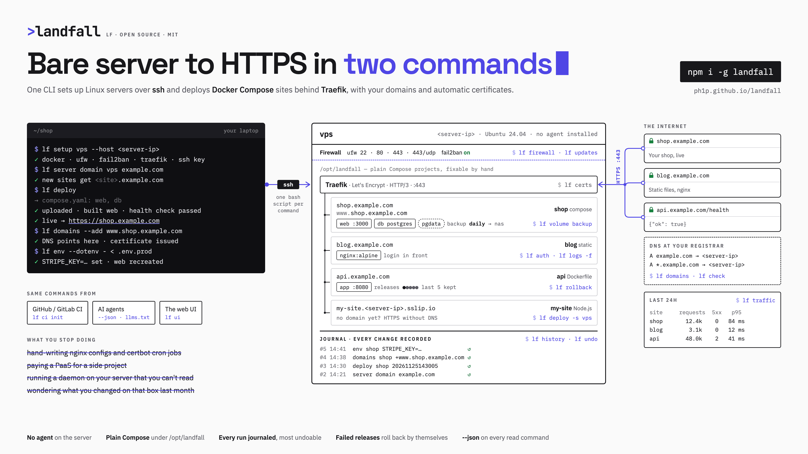

# landfall

One CLI to set up Linux servers and deploy sites to them behind [Traefik](https://traefik.io) with automatic HTTPS.

<picture>
  <source media="(prefers-color-scheme: dark)" srcset="docs/public/landfall-dark.png">
  
</picture>

```sh
npm i -g landfall
lf setup vps --host 203.0.113.7     # fresh Ubuntu/Debian box → Docker, firewall, Traefik, ssh key
cd my-site && lf deploy -s vps      # live at https://my-site.203-0-113-7.sslip.io
```

- **Servers are ssh targets.** If `ssh vps` works, `lf deploy -s vps` works.
- **No agent on the server.** Sites are plain Docker Compose projects under `/opt/landfall`, fixable by hand.
- **Your compose.yaml is the site.** `docker compose up` runs it locally; `lf deploy` runs the same file behind HTTPS.
- **Every change is journaled** on the server. `lf undo` reverts most of them; [History and undo](docs/pages/history.md) lists the rest.
- **The CLI is the product.** Scripts, CI, agents and the web UI (`lf ui`) all run `lf` commands.

`lf` is short for `landfall`. Both are installed.

## Why landfall

- **Setting up a VPS by hand takes many steps.** `lf setup` installs Docker, a firewall, Traefik and an ssh key in one command.
- **Certificates and DNS slow down the first deploy.** A new site gets HTTPS on sslip.io right away. Your own domain is one flag: `-d example.com`.
- **Many deploy tools run a control plane on your server.** landfall installs no agent. It leaves plain Compose projects that you can fix by hand.
- **Server changes can break things.** Every change is journaled on the server, and `lf undo` reverts most of them. A release whose containers do not start rolls back by itself.
- **Deploys should follow git.** Rules say which branches and tags each environment takes. `lf deploy --tag latest`, `lf promote test prod`, `lf ci init` and `lf autodeploy` all keep to them.
- **Day-to-day work is spread over many tools.** Logs, env and secrets, domains, backups, updates, firewall and scans are all `lf` commands.
- **Scripts and agents need stable output.** Read commands print `--json`, and `lf` never prompts without a terminal.

## Install

Your machine needs Node.js 22.4+, `ssh`, `ssh-copy-id` and `tar`. `rsync` makes redeploys faster.

The server needs a root login, or a user with passwordless sudo. landfall installs Docker itself:

- **Ubuntu and Debian**: Docker, ufw, unattended-upgrades, and fail2ban where ssh passwords stay on. No ufw behind an AWS, Google Cloud, Azure, Oracle or Alibaba firewall.
- **Fedora, RHEL-likes, Alpine, SUSE** (dnf, yum, apk, zypper): Docker and rsync. Their base repositories lack the rest.
- **No package manager** (Synology DSM, SteamOS): works when Docker is already there. See [NAS, Steam Deck and other systems](docs/pages/servers.md#nas-steam-deck-and-other-systems-without-a-package-manager).

```sh
npm i -g landfall            # or: pnpm add -g landfall
lf --help                    # all commands
lf <command> --help          # one command's options
```

## Concepts

| term | meaning |
|---|---|
| **server** | An ssh target: a `~/.ssh/config` alias, or one added with `lf server add`/`lf setup`. Pass it as `-s <name>`. The first one added is the default. |
| **site** | One Compose project on a server: your `compose.yaml`, or one generated for a static folder, Dockerfile or image. Services with `x-landfall: { port }` get Traefik routes. |
| **project file** | `./.landfall.json`, written by the first `lf deploy`: `{ "name", "server", "domains" }`. |
| **main domain** | Optional per server (`lf server domain vps example.com`). Sites then default to `<site>.example.com`; `shop` means `shop.example.com`. Without one: `<site>.<ip-with-dashes>.sslip.io`, no DNS needed. |
| **release** | One per deploy, id like `20260122143005`. The last 5 stay (`--keep n`). `lf rollback` switches between them. |
| **run** | One `lf` invocation that changed a server. `lf history` lists runs; `lf undo` reverts them. |

Defaults: **site** `[name]` comes from the argument, else `./.landfall.json`. **server** `-s` comes from the flag, else `./.landfall.json`, else the default server (`lf server use`).

## A first deploy

```sh
lf setup vps --host 203.0.113.7          # once per server: Docker, firewall, Traefik, an ssh key
lf setup vps --minimal                   # or only Docker: no Traefik; reach sites with lf tunnel
cd my-site
lf deploy -s vps                         # → https://my-site.203-0-113-7.sslip.io, no DNS needed
lf deploy -s vps -d example.com          # or your own domain (point its A record at the server first)
lf deploy                                # later: redeploy with ./.landfall.json
```

`lf deploy` detects what the folder is:

| the folder has | landfall |
|---|---|
| a `compose.yaml` | runs it as one Compose project ([Compose sites](docs/pages/compose.md)) |
| a `Dockerfile` | builds it on the server and routes its `EXPOSE`d port |
| an app (Node.js, Bun, Deno, Python, Go, Rust, Java/Kotlin, .NET, Ruby, PHP, Elixir) | writes a Dockerfile and builds it on the server |
| static files (or a site generator's output) | serves them with `nginx:alpine` |
| any folder, with `--image ghcr.io/me/app:1.2 --port 8080` | pulls and runs a prebuilt image |

A release whose containers do not start is rolled back automatically.

## Everyday commands

```sh
lf ls                              # sites with status
lf logs -f                         # follow a site's logs
lf env API_KEY=abc                 # set a variable (recreates the services)
lf domains --add www.example.com   # add a domain
lf rollback                        # previous release
lf deploy -E prod --tag latest     # the newest tag its git rule allows
lf volume backup                   # back up the site's data
lf updates && lf update            # list, then apply OS and image updates
lf history && lf undo              # what landfall changed; revert the last run
lf ui                              # all of this in a local web UI
```

## Documentation

Full docs: [ph1p.github.io/landfall](https://ph1p.github.io/landfall/).

| guide | covers |
|---|---|
| [Servers](docs/pages/servers.md) | `lf setup`, its flags, registering servers, NAS and other systems |
| [Deploy a site](docs/pages/deploy.md) | site kinds, env and secrets, CI, uploads, environments, main domains, running without landfall |
| [Git deploys](docs/pages/git.md) | branch and tag rules per environment, `--ref`/`--tag`, promote, server fetch, CI, auto-deploy |
| [Compose sites](docs/pages/compose.md) | `x-landfall`, routes, private ports, IP allowlists, volumes, published ports |
| [Day-to-day](docs/pages/sites.md) | logs, env, secrets, domains, logins, tunnels, restart, removal |
| [Scaling and load balancing](docs/pages/scaling.md) | replicas, rolling deploys, load balancer options, traffic split |
| [Lifecycle hooks](docs/pages/hooks.md) | npm scripts before and after build, deploy, rollback and removal |
| [Volumes and backups](docs/pages/volumes.md) | volumes, scheduled and offsite backups, push and pull data |
| [Updates](docs/pages/updates.md) | OS packages, images, Docker Compose, vulnerability scans |
| [Traefik](docs/pages/traefik.md) | landfall's Traefik, HTTP/3, the dashboard, your own Traefik |
| [Server administration](docs/pages/system.md) | firewall, services, SSH keys, users, swap, hardening |
| [Traffic, certificates and checks](docs/pages/monitoring.md) | request stats, certificate state, HTTPS checks |
| [History and undo](docs/pages/history.md) | the server journal, what `lf undo` reverts |
| [Plugins](docs/pages/plugins.md) | fail2ban, Trivy, installing and writing plugins |
| [Web UI](docs/pages/web-ui.md) | `lf ui`, its pages and commands, security model |
| [Scripts, CI and AI agents](docs/pages/automation.md) | non-interactive use, `--json`, secrets, exit codes, recipes |
| [Reference](docs/pages/reference.md) | every command, file and environment variable |
| [Troubleshooting](docs/pages/troubleshooting.md) | error messages and fixes |

## Scripts, CI and AI agents

No prompts without a terminal (pass `-y`), `--json` on every read command, secrets on stdin, and `lf undo`. [docs/pages/automation.md](docs/pages/automation.md) is the full contract. For agents, [llms.txt](llms.txt) indexes the docs.

Working on landfall itself? See [CONTRIBUTING.md](CONTRIBUTING.md). Coding agents read [AGENTS.md](AGENTS.md).

## License

MIT
