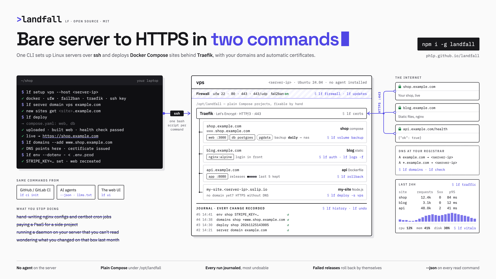

# landfall

Set up Linux servers and deploy sites to them behind [Traefik](https://traefik.io) with automatic HTTPS, from one CLI.



```sh
npm i -g landfall                   # installs both lf and landfall (lf is short for landfall)
lf setup vps --host 203.0.113.7     # fresh Ubuntu/Debian box → Docker, firewall, Traefik, ssh key
cd my-site && lf deploy -s vps      # live at https://my-site.203-0-113-7.sslip.io
```

- **Servers are ssh targets.** Any `~/.ssh/config` alias: if `ssh vps` works, `lf deploy -s vps` works.
- **No agent on the server.** Sites are plain Docker Compose projects under `/opt/landfall`; read, run and fix them by hand.
- **Your compose.yaml is the site.** `docker compose up` runs it locally. `lf deploy` runs the same file behind HTTPS.
- **Every change is journaled** on the server. `lf undo` reverts most of them; [History and undo](history.md) lists the rest.
- **The CLI is the product.** Every feature is an `lf` command first, for scripts, CI and agents. The web UI (`lf ui`) fronts those commands.

## Why landfall

- **Setting up a VPS by hand takes many steps.** `lf setup` installs Docker, a firewall, Traefik and an ssh key in one command.
- **Certificates and DNS slow down the first deploy.** A new site gets HTTPS on sslip.io right away. Your own domain is one flag: `-d example.com`.
- **Many deploy tools run a control plane on your server.** landfall installs no agent. It leaves plain Compose projects that you can fix by hand.
- **Server changes can break things.** Every change is journaled on the server, and `lf undo` reverts most of them. A release whose containers do not start rolls back by itself.
- **Deploys should follow git.** Rules say which branches and tags each environment takes. `lf deploy --tag latest`, `lf promote test prod`, `lf ci init` and `lf autodeploy` all keep to them.
- **Day-to-day work is spread over many tools.** Logs, env and secrets, domains, backups, updates, firewall and scans are all `lf` commands.
- **Scripts and agents need stable output.** Read commands print `--json`, and `lf` never prompts without a terminal.

## Concepts

| term | meaning |
|---|---|
| **server** | An ssh target: a `~/.ssh/config` alias, or one registered with `lf server add`/`lf setup`. Pass it as `-s <name>`. The first server you add becomes the default. |
| **site** | One Compose project on a server: your `compose.yaml`, or one landfall generates for a static folder, a Dockerfile or a prebuilt image. Traefik routes services that have `x-landfall: { port }`. |
| **project file** | `./.landfall.json`, written by the first `lf deploy`: `{ "name", "server", "domains" }`. |
| **main domain** | Optional, per server: `lf server domain vps example.com`. Sites then default to `<site>.example.com`, and a bare name like `shop` means `shop.example.com`. Without one, sites get `<site>.<ip-with-dashes>.sslip.io` (e.g. `blog.203-0-113-7.sslip.io`), which needs no DNS setup. |
| **release** | Every deploy creates one, with an id like `20260122143005`. The last 5 are kept (`--keep n` for more). `lf rollback` switches between them, back and forth. |
| **run** | One landfall invocation that changed a server. `lf history` lists runs. `lf undo` reverts them. |

Every command resolves defaults the same way:

- **site** `[name]`: the argument, else `name` from `./.landfall.json`.
- **server** `-s`: the flag, else `server` from `./.landfall.json`, else the default server (`lf server use`).

## Where to start

| guide | covers |
|---|---|
| [Try it locally](try-locally.md) | a Docker container as a test server: setup, deploy, tenants, no VPS needed |
| [Servers](servers.md) | `lf setup` for fresh and existing servers, setup flags, registering servers, NAS and other systems |
| [Deploy a site](deploy.md) | site kinds, env and secrets, CI, what gets uploaded, environments, main domains |
| [Git deploys](git.md) | branch and tag rules per environment, `--ref`/`--tag`, promote, server fetch, CI, auto-deploy |
| [Compose sites](compose.md) | `x-landfall`, routes, private ports, IP allowlists, volumes, published ports |
| [Day-to-day](sites.md) | logs, releases, env, secrets, domains, logins, tunnels, restart and removal |
| [Scaling and load balancing](scaling.md) | replicas, rolling deploys, load balancer options, traffic split |
| [Lifecycle hooks](hooks.md) | commands or npm scripts before and after build, deploy, rollback and removal |
| [Volumes and backups](volumes.md) | volumes, backups, scheduled and offsite backups, push and pull data |
| [Updates](updates.md) | OS packages, images, Docker Compose, vulnerability scans |
| [Traefik](traefik.md) | landfall's Traefik, HTTP/3, the dashboard, using your own Traefik |
| [Server administration](system.md) | firewall, services, SSH keys, users, swap, hardening |
| [Traffic, certificates and checks](monitoring.md) | request stats, certificate state, HTTPS checks |
| [Analytics](analytics.md) | visitors, sources, funnels, events and web vitals on your own server, cookieless by default |
| [History and undo](history.md) | the server journal and what `lf undo` can revert |
| [Plugins](plugins.md) | exposure checks, fail2ban and Trivy, installing plugins, writing your own commands and web UI sections |
| [Web UI](web-ui.md) | `lf ui`, its pages and their commands, security model |
| [Scripts, CI and AI agents](automation.md) | non-interactive use, `--json`, secrets, exit codes, recipes |
| [Reference](reference.md) | every command, local and remote files, environment variables |
| [Troubleshooting](troubleshooting.md) | error messages and their fixes |
